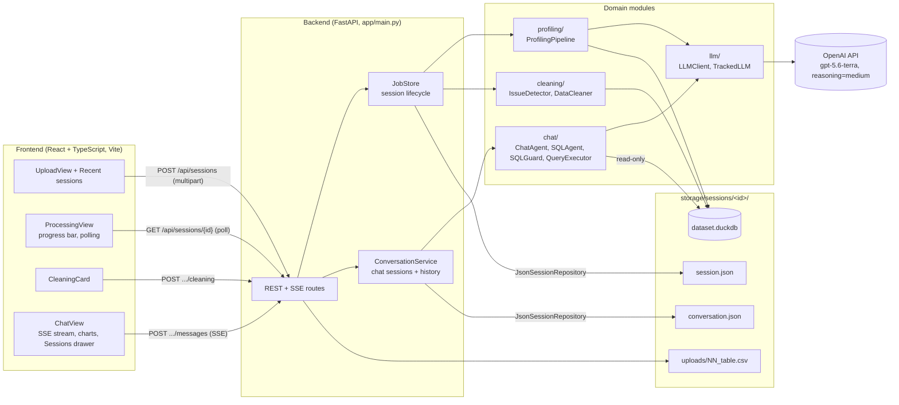
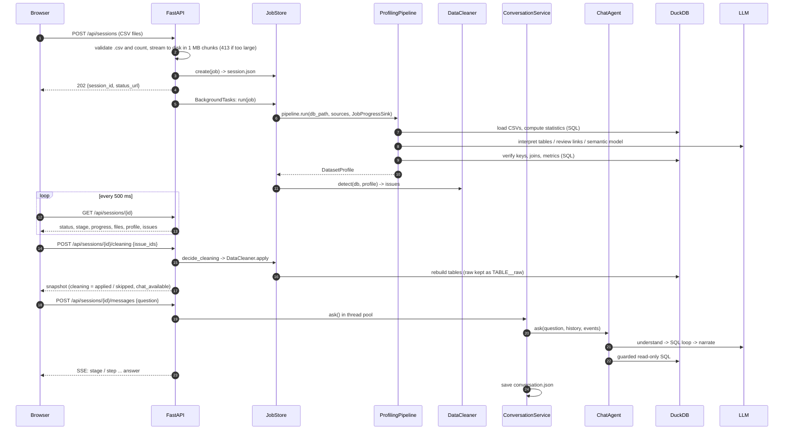
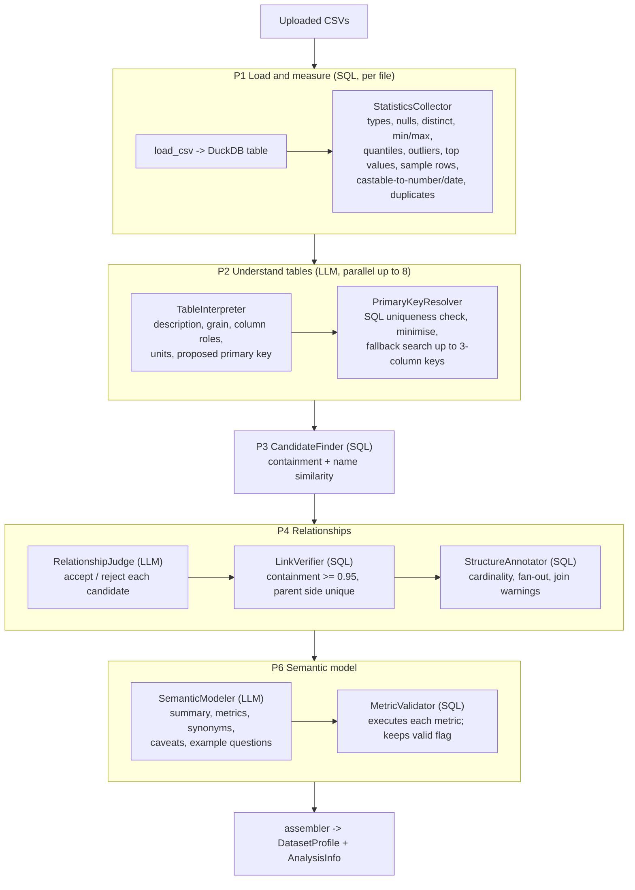
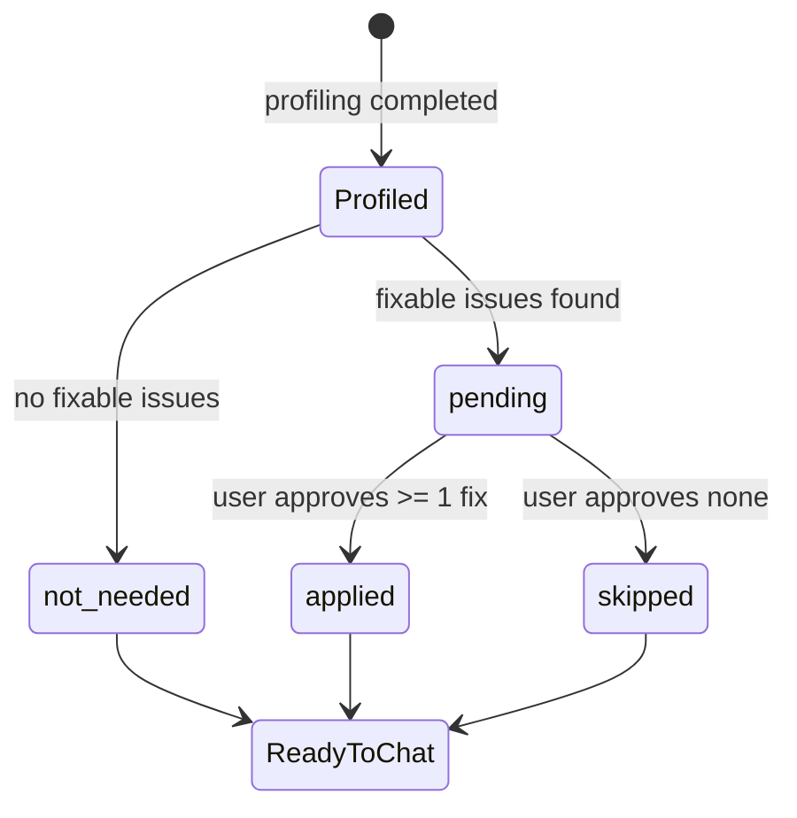
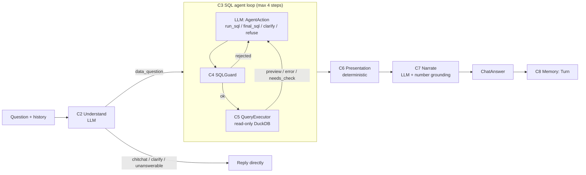
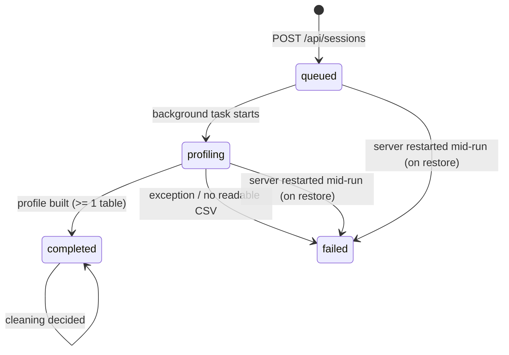

# CSV Chat Analyst: Architecture

This document explains how the system is built and why. It covers the techniques used, how each stage (profiling, cleaning, chat) works, how data moves between them, and how sessions are kept.

Related documents give more detail on single stages:
- [profiling-design.md](./profiling-design.md): profiling stages, thresholds, experiment results.
- [chat-design.md](./chat-design.md): chat decisions, prompts, the evaluation.
- [profiling-research.md](./profiling-research.md) and [chat-agent-research.md](./chat-agent-research.md): the research this design is based on.

---

## 1. The problem and the approach

**Problem.** A user uploads several related CSV files (orders, customers, products, …) and wants to ask business questions in plain English: "What was revenue by region last quarter?", "Which customers bought more than 5 times?". The answers must be correct. That means the system has to:

1. understand files it has never seen: column types, keys, how the tables join, what the columns mean;
2. deal with messy data: whitespace, `"N/A"` placeholders, numbers and dates stored as text, duplicates;
3. turn a question (often a follow-up) into a correct query over several tables;
4. show the answer as text, a table or a chart, with numbers that really come from the data.

**Approach: SQL-first, the LLM judges, SQL verifies.**

| Principle | What it means here |
|---|---|
| **SQL-first computation** | All numbers come from DuckDB queries. The LLM never does arithmetic on data. It writes SQL, and DuckDB runs it. |
| **SQL gathers evidence, the LLM judges, SQL verifies** | Deterministic SQL collects facts (statistics, candidate joins). The LLM interprets them (meaning, roles, which joins are real). SQL then re-checks every LLM claim (is the key unique? does the join contain its values? does the metric run?). |
| **Structured outputs** | Every LLM call returns a Pydantic model through JSON-schema structured output. No free-text parsing. |
| **Human in the loop for changes** | Data is never changed without the user approving it (the cleaning gate). |
| **Graceful degradation** | Every LLM step has a deterministic fallback (heuristics or templates). An LLM failure lowers quality but does not stop the system. |
| **Defence in depth** | Generated SQL passes an AST guard *and* runs on a read-only, sandboxed connection with row and time limits. |
| **Transparency** | Every answer shows its SQL, its assumptions, the agent's steps, data-quality notes and the LLM calls/latency. |

---

## 2. System overview



### Tech stack

| Layer | Technology | Why |
|---|---|---|
| Frontend | React 18 + TypeScript, Vite, Recharts | Simple SPA; Vite proxies `/api` to the backend in development. |
| API | FastAPI, Starlette `BackgroundTasks`, `StreamingResponse` (SSE) | Async I/O for uploads and streams; sync work runs in the thread pool. |
| Analytical engine | DuckDB, one file per session | Fast columnar SQL over CSVs; a single embedded file per dataset; can be opened read-only for chat. |
| SQL safety | SQLGlot (DuckDB dialect) | Parses SQL into an AST so the guard checks structure, not text. |
| LLM | OpenAI SDK structured outputs (`chat.completions.parse` with a Pydantic `response_format`), `gpt-5.6-terra`, `reasoning_effort=medium` | Typed, validated outputs; the SDK retries with backoff. |
| Contracts | Pydantic v2 | API schemas, LLM output schemas, stored records. |
| Persistence | JSON files written atomically (tmp + `os.replace`) | No extra infrastructure for a proof of concept; sits behind a repository interface. |

### Backend code layout

```
backend/app/
  main.py            create_app(): routes, upload streaming, SSE endpoint, lifespan
  config.py          Settings / LLMSettings from environment variables
  jobs.py            Job state machine, JobStore, JobProgressSink (profiling -> job adapter)
  conversations.py   ConversationService: per-session ChatSession, history, CSV download
  databases.py       ReadOnlyDatabases: one shared read-only QueryExecutor per session
  tables.py          TableBrowser: paged, sortable table rows for the UI viewer
  persistence.py     SessionRepository protocol + JsonSessionRepository
  streaming.py       QueueChatEvents: worker thread -> asyncio queue -> SSE
  schemas.py         Pydantic API / profile models (DatasetProfile, ChatMessage, ...)
  llm/               base (protocols), openai_client (adapter), tracking (decorator), factory
  profiling/         pipeline, statistics, interpreters, keys, relationships, judges,
                     semantics, assembler, progress, prompts, contracts, factory
  cleaning/          detector, cleaner, sql (fix expressions), notes (DataNotes for chat)
  chat/              agent, understanding, sql_agent, guard, executor, presentation,
                     narration, grounding, context, memory, notes, prompts, contracts, factory
```

---

## 3. Design techniques and principles

### 3.1 Patterns used

| Pattern | Where | Purpose |
|---|---|---|
| **Strategy** | `TableInterpreter`, `RelationshipJudge`, `SemanticModeler` (profiling); `Understander`, `Narrator` (chat). Each has an `LLM…` and a heuristic, `Null…` or `Template…` version. | Swap the LLM for a deterministic implementation without changing the pipeline. |
| **Dependency inversion / protocols** | `llm/base.py` defines `LLMClient` and `StructuredLLM` as `typing.Protocol`. | Profiling and chat never import the OpenAI SDK. Only `llm/openai_client.py` does. |
| **Factory / composition root** | `ProfilingPipelineFactory`, `ChatAgentFactory`, `build_llm_client`, `create_app(settings, pipeline_factory, chat_factory)` | All wiring happens in one place. Tests inject fakes. Experiment variants (`ONE_SHOT`, `LOOP_ONLY`, `HYBRID`) are just configurations. |
| **Decorator** | `TrackedLLM` wraps an `LLMClient` | Counts calls, tokens, latency and errors per run, without changing the client. |
| **Adapter** | `OpenAIClient` (SDK → `LLMClient`); `JobProgressSink` (`ProgressSink` → `Job` fields); `QueueChatEvents` (`ChatEvents` → SSE) | Domain code talks to small interfaces; adapters connect them to infrastructure. |
| **Repository** | `SessionRepository` / `JsonSessionRepository` | Storage can be replaced (e.g. Postgres) without touching `JobStore` or `ConversationService`. |
| **Observer** | `ProgressSink` (profiling), `ChatEvents` + the `observe` callback (chat) | The pipelines report progress without knowing how it is shown. |
| **State machine** | `Job.status` + `Job.cleaning` | Explicit, persisted lifecycle; invalid transitions return 409. |
| **Template fallback** | `_attempt(primary, fallback)` in profiling; `PassThroughUnderstander`, `TemplateNarrator` in chat | Graceful degradation, recorded in `notes` / `analysis.degraded`. |

### 3.2 SOLID mapping

- **S: single responsibility.** Each module does one job. `StatisticsCollector` only measures. `PrimaryKeyResolver` only verifies keys. `SQLGuard` only checks SQL. `QueryExecutor` only runs it. `resolve_presentation` only chooses a view.
- **O: open/closed.** A new judge, narrator or storage backend is a new class that implements the protocol. The pipelines stay unchanged.
- **L: Liskov substitution.** The heuristic and LLM strategies return the same contract types (`TableInterpretation`, `RelationshipReview`, `Understanding`, …). Either can be used anywhere.
- **I: interface segregation.** Pipeline steps depend on `StructuredLLM.parse(step, system, user, schema)` only, not the whole client. Progress uses a two-method `ProgressSink`.
- **D: dependency inversion.** High-level orchestration (`ProfilingPipeline`, `ChatAgent`) depends on protocols. Concrete classes are injected by the factories.

---

## 4. End-to-end lifecycle



---

## 5. Stage 1: Profiling (ingestion and understanding)

**Goal.** Turn raw CSVs into a verified `DatasetProfile`: tables, typed columns with roles and descriptions, primary keys, relationships with cardinality and fan-out, and a semantic model (metrics, synonyms, caveats). This profile is the only description of the data the chat agent sees.

Code: `profiling/pipeline.py` (orchestration), with one module per step.

### 5.1 Workflow



| Step | Kind | What it does | Verification |
|---|---|---|---|
| **P1 Load and measure** | SQL | `read_csv` into a DuckDB table per file (`safe_table_name`), then one aggregate query per table for all column statistics. Files that fail to load are recorded as `FailedFile`; the run continues. | Deterministic. |
| **P2 Understand** | LLM, parallel (`ThreadPoolExecutor`, `max_parallel_calls = 8`) | For each table: a description, the grain, each column's role (`identifier`, `dimension`, `measure`, `time`, `text`, `boolean`) and description and unit, and a proposed primary key. | `PrimaryKeyResolver` checks uniqueness in SQL. A key that passes is `llm_verified`; one reduced to fewer columns is `llm_minimised`. Otherwise a unique single column or a composite key of up to 3 columns is searched (`sql_fallback`). |
| **P3 Candidates** | SQL | For each parent table with a single-column key, each child column is a candidate if containment ≥ 0.5, or if name similarity ≥ 0.6 and containment ≥ 0.2. Self-links and links from a table's own key are filtered out. | Uses measured containment, orphan rows and parent coverage. |
| **P4 Relationships** | LLM decides, SQL verifies | The judge accepts or rejects candidates using the SQL evidence. `LinkVerifier` keeps a link as *accepted* only if containment ≥ 0.95 and the parent column is unique. Links with containment 0.5–0.95 become `needs_review`. `StructureAnnotator` adds cardinality (1:1, N:1), average fan-out and a join warning. | The LLM cannot create a link that SQL does not support. |
| **P6 Semantic model** | LLM, then SQL | Business vocabulary: a dataset summary, named metrics (`SUM(...)` expressions), synonyms ("revenue" → `order_items.price * quantity`), caveats, example questions. | `MetricValidator` runs `SELECT <expression> FROM <table>`. Metrics that fail are kept with `valid = false` and are not given to the chat agent. |

### 5.2 Data flow and intermediate models

```
CSV file
  └─> DuckDB table                    (dataset.duckdb)
        └─> TableStats / ColumnStats  (P1: pure measurements)
              └─> TableModel          (P2: + roles, descriptions, verified primary key)
                    └─> LinkCandidate (P3: + containment evidence)
                          └─> Link    (P4: accepted / needs_review, cardinality, fan-out)
                                └─> SemanticModel (P6: validated metrics, synonyms, caveats)
                                      └─> DatasetProfile (+ AnalysisInfo) -> session.json -> API -> UI
```

The internal models live in `profiling/models.py`, the LLM output contracts in `profiling/contracts.py`, and the public `DatasetProfile` in `schemas.py`. The assembler is the only place where internal models become API models.

### 5.3 Fallback and degradation

The pipeline runs with a `Strategies(interpreter, judge, semantic)` bundle:

- **LLM strategies:** `LLMTableInterpreter`, `LLMRelationshipJudge`, `LLMSemanticModeler`, all sharing one `TrackedLLM` per run.
- **Heuristic strategies:** `HeuristicTableInterpreter` (name and type rules), `HeuristicRelationshipJudge` (accept on strong evidence), `NullSemanticModeler`.

Each LLM step runs through `_attempt(primary, fallback)`. Any exception switches that step to the heuristic, sets `analysis.degraded = true` and adds a note. With `LLM_ENABLED=false` the whole run uses heuristics, so profiling never needs the network.

### 5.4 Progress reporting

`ProgressTracker` converts pipeline events into one weighted fraction. Each file counts as 2 units (load + statistics). Then come the dataset stages: understanding (weight 3, reported as *n/N* tables), relationships (1), review (2), semantic (2). Progress is capped at 0.99 until the job completes. `JobProgressSink` writes this into the `Job` (progress only moves forward, using `max`). The browser polls `GET /api/sessions/{id}` every 500 ms to draw the progress bar and per-file status.

### 5.5 Results

With `gpt-5.6-terra`, reasoning `medium`, relationship F1, primary-key accuracy and role accuracy are 1.0 on the evaluation datasets:

| Dataset | LLM calls | Time |
|---|---|---|
| jaffle | 5 | ~15 s |
| chinook | 13 | ~26 s |
| tpch | 10 | ~29 s |

On the 8-table sample (78,206 rows) profiling finds 8 relationships and 10 valid metrics. See [profiling-design.md](./profiling-design.md).

---

## 6. Stage 2: Cleaning (the human-approved gate)

**Goal.** Fix common data-quality problems before analysis, but only with the user's approval, and keep the original data.

Code: `cleaning/detector.py`, `cleaning/cleaner.py`, `cleaning/sql.py`, `cleaning/notes.py`.

### 6.1 Workflow



1. **Detect** (`IssueDetector`, SQL only, read-only connection). It runs after profiling and finds:

   | Kind | Detection | Fix |
   |---|---|---|
   | `duplicate_rows` | `duplicate_row_count` from P1 | `SELECT DISTINCT` |
   | `whitespace` | `col <> trim(col)` | `trim()` |
   | `null_tokens` | `lower(trim(col))` in a placeholder list (`n/a`, `null`, `-`, …) | turn them into `NULL` |
   | `numeric_text` | ≥ 98% of non-null values cast to a number, no leading zeros, not an identifier | `TRY_CAST` to `BIGINT` or `DOUBLE` (chosen from the data) |
   | `date_text` | ≥ 98% parse as dates (mixed formats supported) | convert to `DATE` |
   | `case_variants` | low-cardinality text with several spellings of one value | map each to its most frequent spelling |
   | `missing_values`, `outliers` | from statistics | *informational only, no fix* |

   Each issue has an id, affected row count, examples and a proposed fix. `Job.cleaning` becomes `pending` if at least one issue has a fix.

2. **Decide.** `CleaningCard` lists the issues with examples. The user picks fixes and calls `POST /api/sessions/{id}/cleaning {issue_ids}`. This can be done only once, only while `pending`, and is protected by `cleaning_busy` and the job lock (409 otherwise). Chat returns 409 while cleaning is `pending`.

3. **Apply** (`DataCleaner.apply`). For each affected table, inside one transaction:
   - build one `SELECT` that applies the column fixes in a fixed order (`whitespace → null_tokens → case_variants → numeric_text → date_text`), adding `DISTINCT` for duplicates;
   - `CREATE TABLE t__clean AS …`; rename `t` → `t__raw`; rename `t__clean` → `t`.

   The cleaned table **keeps the original name**, so the profile, relationships and metrics still refer to it. The raw copy `t__raw` is not in the schema context, so the SQL guard rejects queries on it.

4. **Refresh.**
   - Statistics are collected again for rebuilt tables. A column's role is updated if its type changed (e.g. text → number becomes `measure`). A primary key is searched again if removing duplicates made a column unique.
   - Metrics are re-validated (a metric over a text column may now run).
   - A caveat is added at the top of the semantic model listing the applied fixes, so the chat agent does not "re-clean" in SQL (no extra `TRIM` / `TRY_CAST`).
   - Remaining issues are detected again.

5. **Carry forward.** Issues that remain unresolved become `DataNote`s (`cleaning/notes.py → chat/notes.py`). When an answer's SQL touches that table or column, the note is shown under the answer (`data_quality`).

---

## 7. Stage 3: The chat agent

**Goal.** Answer questions, including follow-ups, with correct SQL, choose a suitable view, and explain the result with numbers that can be traced to it.

### 7.1 Orchestration style: a hybrid pipeline

The chat agent is **neither a free-form autonomous agent nor a single prompt**. It is a **fixed outer pipeline** (predictable, testable, cheap) with **one bounded agentic loop** inside it (the SQL step, ReAct-style: think → act → observe). The loop is where trial and error actually helps.



Why hybrid: in the eval (`experiments/chat/exp01_hybrid`) the `ONE_SHOT` and `LOOP_ONLY` configurations were compared with `HYBRID`. HYBRID reached **35/35** execution accuracy (chinook 14, jaffle 10, tpch 11), plus 6/6 behaviour cases and 11/11 chart cases, with a p50 latency of 5.9 s. A typical simple question uses 3 LLM calls (understand, one `final_sql`, narrate).

### 7.2 Stages

| Stage | Module | Kind | Input → output |
|---|---|---|---|
| **C1 Schema context** | `context.py` | deterministic, built once per session | `DatasetProfile` → `SchemaContext`: DAIL-SQL / M-Schema-style `TABLE` blocks (type, role, description, unit, FK, ranges, sample values, null %), relationships with fan-out and warnings, data time range, validated metrics, synonyms, caveats. Also the table and column sets the guard uses. |
| **C2 Understand** | `understanding.py` | LLM (`Understanding`) | question + last 6 turns → `standalone_question` (follow-ups resolved), `intent` (`data_question` / `clarification_needed` / `unanswerable` / `chitchat`), requested `output` (auto / text / table / chart), `time_window`, `assumptions`, `reply`. If the LLM fails, `PassThroughUnderstander` uses the question as is. |
| **C3 SQL agent** | `sql_agent.py` | LLM loop (`AgentAction`) | Each step returns `thought`, `action`, `sql`, `message`, `assumptions`, `presentation`. `run_sql` runs a query and returns a 20-row preview (exploration). `final_sql` runs the answer query in full. `clarify` and `refuse` end the loop. Guard rejections and SQL errors go back into the transcript so the next step can fix them. The last step is forced to be final. |
| **C3 repair (`needs_check`)** | `sql_agent.py` | LLM | If a final result is **empty** or the guard flags a **fan-out risk**, the agent gets one `needs_check` turn to confirm or fix it. If the repair fails, the pending result is kept. |
| **C4 SQL guard** | `guard.py` | deterministic (SQLGlot AST) | Exactly one statement, which must be a `SELECT`/query. Forbidden nodes: `INSERT`, `UPDATE`, `DELETE`, DDL, `COPY`, `ATTACH`, `PRAGMA`, `SET`, `SELECT … INTO`. Forbidden functions: `read_csv*`, `read_parquet`, `glob`, `*_scan`, `getenv`, …. Unknown tables are rejected (CTE names allowed). Fan-out warning: `SUM`/`AVG` (without `DISTINCT`) of a parent column while a many-side child table is joined in the same scope. |
| **C5 Executor** | `executor.py` | DuckDB | `read_only=True`, `enable_external_access=false`, at most 1,000 rows (it fetches 1,001 to detect truncation), 30 s timeout (`threading.Timer` → `interrupt()`). Error messages are cleaned so they are safe to show and feed back. One shared connection per database. |
| **C6 Presentation** | `presentation.py` | deterministic | The LLM's view hint is validated against the result shape (column kinds number / time / category). An explicit user request (table / text / chart) wins. A requested chart is used only if it fits: a line chart needs a time x-axis and ≥ 3 points; bar charts ≤ 40 categories; pie ≤ 6 non-negative slices; scatter needs numeric x. Otherwise one category plus 1–3 numbers becomes an auto bar or line chart; a single value becomes text; anything else a table. |
| **C7 Narrate** | `narration.py`, `grounding.py` | LLM + check | Writes a short answer from the result, assumptions and data notes. `ungrounded_numbers` extracts every figure (handles `1,234`, `12.5%`, `1.2M`) and checks it against result values (with rounding and percent rules), row and column counts, date parts, and numbers in the question, assumptions or notes. If any figure is not grounded, or the LLM fails, `TemplateNarrator` writes a plain summary and a note records why. |
| **C8 Memory** | `memory.py` | data | Each answer becomes a `Turn(question, standalone_question, sql, result_preview (5 rows), answer)`. The last 6 turns are rendered into C2 and C3 prompts, so "and by month?" can reuse the earlier SQL. |

### 7.3 The answer contract

`ChatAgent.ask` returns `ChatAnswer`:

| Field | Description |
|---|---|
| `status` | `answered`, `clarify`, `refuse`, `chitchat` or `failed` |
| `message` | the narrative or reply |
| `sql` | the verified final query |
| `result` | columns, rows, row count, truncated flag |
| `presentation` | kind, chart type, x, y, series, title |
| `assumptions` | from the understander and the SQL agent, de-duplicated |
| `warnings` | e.g. fan-out risk |
| `steps` | the agent trace, shown as "How I got this (N steps)" |
| `notes` | degraded-mode notes |
| `data_quality` | unresolved issues touching this SQL |

`ConversationService.to_message` maps it to the API `ChatMessage`, adding `elapsed_s` and `llm_calls`.

### 7.4 Streaming (SSE) and threading

The agent code is synchronous (the SDK, DuckDB). The API is asynchronous. `streaming.py` connects them:

```
POST /api/sessions/{id}/messages
  └─ QueueChatEvents(loop)                              # implements ChatEvents
  └─ asyncio.create_task(work):
        run_in_threadpool(conversations.ask, id, q, events)   # agent runs in a worker thread
          events.stage("understanding" | "querying" | "presenting" | "narrating")
          events.step(AgentStep)                              # each SQL-loop step
            └─ loop.call_soon_threadsafe(queue.put_nowait, sse(...))
        then emit("answer", ChatMessage) or emit("error", {...}); close()
  └─ StreamingResponse(events.stream(), media_type="text/event-stream",
                       headers: Cache-Control: no-cache, X-Accel-Buffering: no)
```

Event types: `stage` (name, label, detail), `step` (index, action, outcome, detail, sql), `answer` (the full `ChatMessage`), `error`. The frontend reads the stream with `fetch` + `ReadableStream` (`api.ts`) and shows the live stage label and steps until the answer arrives.

Concurrency: each conversation has a lock, so one question runs at a time per dataset; different sessions run in parallel. Input limits: questions up to 2,000 characters; 409 if the dataset is not ready; 503 if no LLM is configured.

### 7.5 Configurations

`ChatConfig(understand, max_steps, repair, narrate, max_rows=1000, timeout_s=30)`:

| Name | Settings |
|---|---|
| `HYBRID` (default) | understand, 4 steps, repair, narrate |
| `LOOP_ONLY` | no understanding step |
| `ONE_SHOT` | 1 step, no repair, template narration |

`ChatAgentFactory.create(profile, db_path, data_notes, executor)` returns a `ChatSession(agent, llm, executor, context)`.

---

## 8. Sessions and state

### 8.1 The session (job) model

A *session* is one uploaded dataset plus its conversation. In `jobs.py`, `Job` holds:

| Group | Fields |
|---|---|
| Lifecycle | `status`: `queued → profiling → completed`, or `failed`; `stage`, `progress`, `error`, per-file `FileProgress` |
| Results | `profile` (`DatasetProfile`), `issues`, `cleaning` (`not_needed`, `pending`, `applied`, `skipped`), `applied_fixes` |
| History metadata | `created_at`, `updated_at`, `title`, `question_count` |
| Concurrency | a `threading.Lock` per job; `cleaning_busy` |
| Derived | `ready_for_chat = status == completed and cleaning != pending` |



### 8.2 What is stored, and where

```
storage/sessions/<uuid4 hex>/
  uploads/01_orders.csv ...   original files, numbered to keep upload order
  dataset.duckdb              loaded (and cleaned) tables, plus <table>__raw copies
  session.json                StoredSession: lifecycle, files, profile, issues, cleaning, title, counts
  conversation.json           StoredConversation: ChatMessages (for the UI) + Turns (for agent memory)
```

- **Writes.** `JobStore._persist` saves `session.json` after every state change (start, file status, progress, completion, cleaning, each question). `ConversationService.ask` saves `conversation.json` in a `finally` block, so a failed answer still keeps the user's question. Writes are atomic: write `*.json.tmp`, then `os.replace`. A lock in the repository serialises writes. Persistence errors are logged and never fail the request.
- **Two views of the conversation.** `messages` are what the UI shows (full tables, charts, steps). `turns` are what the agent remembers (compact SQL and a 5-row preview). Storing both means a restored session looks the same *and* answers follow-ups with the same context.

### 8.3 Restore after a restart

At startup `JobStore._restore` loads every valid `session.json` (`JsonSessionRepository.load_sessions` skips unreadable files and files whose folder name does not match). `Job.from_record` marks any session that was `queued` or `profiling` as `failed` with an "interrupted" error, because the background task died with the process. Completed sessions keep their profile, issues and cleaning state.

Conversations load lazily. The first `ask`, or `download.csv`, for a session calls `ChatAgentFactory.create` and rebuilds `turns` and `messages` from `conversation.json`. `GET /messages` reads directly from storage if the conversation is not in memory. On shutdown (lifespan) `close_all` closes the read-only DuckDB connections. These connections are owned by `ReadOnlyDatabases` and shared by the chat agent and the table viewer (`TableBrowser`). DuckDB allows only one connection configuration per file in a process, and a closed executor reconnects lazily.

### 8.4 History in the UI

- `GET /api/sessions` returns `SessionSummary` records (title, status, cleaning state, file names, table count, total rows, question count, timestamps), newest first. The first question becomes the title (up to 80 characters, with "…"). Before that, the title is the first three file names ("+N more").
- **Routing.** The SPA uses hash routes, `#/session/<id>`, with `pushState` and `popstate`. A reload or a bookmark opens the same session. A session that is still profiling resumes the progress view ("watch mode"). Back and forward switch between sessions.
- **Screens.** `upload → loading → processing (progress + CleaningCard) → chat` (`App.tsx`). The upload page lists recent sessions. The chat top bar has a *Sessions* drawer (`SessionList`) that highlights the active session and switches to others.

### 8.5 New chat on the same data

Users often want a fresh conversation on a dataset they have already uploaded. `POST /api/sessions/{id}/copy` (`JobStore.copy_dataset`) creates a new session without re-uploading or re-profiling, so no LLM calls are made:

- Under the source job's lock, it requires `status == completed`, a profile, and no cleaning in progress (otherwise `CopyConflictError` → 409). Holding the lock means a cleaning decision cannot rewrite `dataset.duckdb` mid-copy.
- It copies `uploads/` and `dataset.duckdb` (plus `.wal` if present) into a new session folder. The new `Job` starts `completed`, with a deep copy of the profile and the same `issues`, `cleaning` state and `applied_fixes`. The conversation is empty, and the title reverts to the file names until the first question. If anything fails, the new folder is deleted.
- Sessions stay fully independent. Each has its own DuckDB file, so a copy whose cleaning is still `pending` can be decided differently from the source. The cost is duplicated disk space.
- **UI.** A *New chat* button in the chat top bar, and on every completed session in `SessionList` (upload page and drawer), calls `copySession` and opens the new session.

---

## 9. API reference

| Method | Path | Purpose |
|---|---|---|
| `POST` | `/api/sessions` | Upload CSVs (multipart). Returns `202 {session_id, status_url}`; profiling runs in the background. Errors: 400 (no files, too many files, not a `.csv`, empty file), 413 (file too large). |
| `GET` | `/api/sessions` | List sessions (history), newest first. |
| `GET` | `/api/sessions/{id}` | Status snapshot: status, stage, progress, files, profile, issues, cleaning, `chat_available`. |
| `POST` | `/api/sessions/{id}/cleaning` | `{issue_ids: [...]}`. Applies the selected fixes once. 409 if not pending or busy. |
| `POST` | `/api/sessions/{id}/copy` | `JobStore.copy_dataset`: a new session on the same data (files, DuckDB, profile, cleaning state) with an empty chat. 201 `{session_id}`; 404 for an unknown session; 409 if not completed or cleaning is busy (§8.5). |
| `GET` | `/api/sessions/{id}/messages` | Conversation messages (`[]` if not ready). |
| `POST` | `/api/sessions/{id}/messages` | `{question}` → SSE stream (`stage`, `step`, `answer`, `error`). 409 not ready, 503 no LLM. |
| `GET` | `/api/sessions/{id}/messages/{mid}/download.csv` | Re-runs the message's verified SQL with up to 100,000 rows and returns CSV. |
| `GET` | `/api/sessions/{id}/tables/{table}/rows` | `TableBrowser`: `offset`, `limit` (≤ 200), optional `sort`/`desc`. The table and column are checked against the profile and quoted; the default order is `rowid`, and sorting uses `NULLS LAST`. 409 until the session is ready for chat; 404 for an unknown or `__raw` table. |

---

## 10. Security and limits

| Concern | Control |
|---|---|
| Malicious or accidental writes from generated SQL | SQLGlot AST guard (single read-only `SELECT`, forbidden nodes) **and** a `read_only=True` DuckDB connection. |
| File system or network access from SQL | Guard blocks `read_*`, `glob`, `*_scan`, `getenv`, `ATTACH`, `COPY`; executor sets `enable_external_access=false`. |
| Querying raw or unknown tables | Guard allows only tables in the schema context (plus CTEs); `__raw` copies are not in it. |
| Runaway queries | 30 s timeout with `interrupt()`; 1,000-row cap for chat (100,000 for CSV download). |
| Upload abuse | `.csv` only, at most 20 files, at most 100 MB per file (streamed in 1 MB chunks, rejected early); table names sanitised. |
| Prompt size and abuse | Questions ≤ 2,000 characters; history capped at 6 turns; previews capped at 20 rows. |
| Hallucinated numbers | Number grounding check, with a template fallback. |
| Secrets | `OPENAI_API_KEY` only in the backend environment (`.env`), never sent to the browser. CORS limited to configured origins, GET and POST. |

---

## 11. Observability

- **LLM accounting.** `TrackedLLM` records every call: step name, prompt and completion tokens, latency, error. Profiling reports them in `profile.analysis` (`llm_calls`, tokens, per-stage `timings_s`, `degraded`, `notes`). Each chat message reports `llm_calls` and `elapsed_s`.
- **Agent trace.** Every SQL-loop step (action, outcome, detail, SQL) is streamed live and stored on the message ("How I got this").
- **Degradation notes.** Fallbacks are always recorded (`analysis.notes`, `ChatAnswer.notes`), never silent.
- **Logging.** Standard `logging`: LLM failures are warnings; persistence failures are logged with their stack trace.

---

## 12. Configuration

| Variable | Default | Effect |
|---|---|---|
| `OPENAI_API_KEY` | none | Required for LLM profiling and for chat. |
| `LLM_ENABLED` | `true` | `false` means heuristic profiling only; chat is unavailable. |
| `OPENAI_MODEL` | `gpt-5.6-terra` | Model for all LLM steps. |
| `OPENAI_REASONING_EFFORT` | `medium` | Used for reasoning models; classic models get `temperature=0`. |
| `STORAGE_DIR` | `backend/storage` | Root for session folders. |
| `MAX_FILES` / `MAX_FILE_SIZE_MB` | `20` / `100` | Upload limits. |
| `CORS_ORIGINS` | `http://localhost:5173,http://127.0.0.1:5173` | Allowed browser origins. |

---

## 13. Known limitations and how to scale

| Limitation today | Path forward |
|---|---|
| Background work uses FastAPI `BackgroundTasks` in the API process; a restart marks running jobs as failed. | A job queue (Celery / RQ / Arq) with retries and resumable stages. |
| JSON files in a local folder; a single process. | A Postgres implementation of `SessionRepository`; object storage for uploads and DuckDB files. |
| No authentication; every session is visible to anyone who can reach the API. | Add users and ownership on sessions; signed session URLs. |
| No session deletion or renaming. | `DELETE` / `PATCH` routes plus a retention policy. |
| The status page polls. | Use SSE for profiling progress too (the chat stream already does). |
| The full schema context goes into every prompt; fine for tens of tables. | Schema linking / retrieval (CHESS-style) for large schemas. |
| No caching of repeated questions. | Cache by (dataset version, standalone question) → SQL. |
| One question at a time per session. | Fine for chat UX; per-user rate limits for multi-tenant use. |
